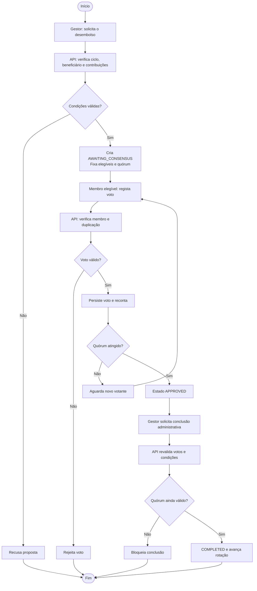
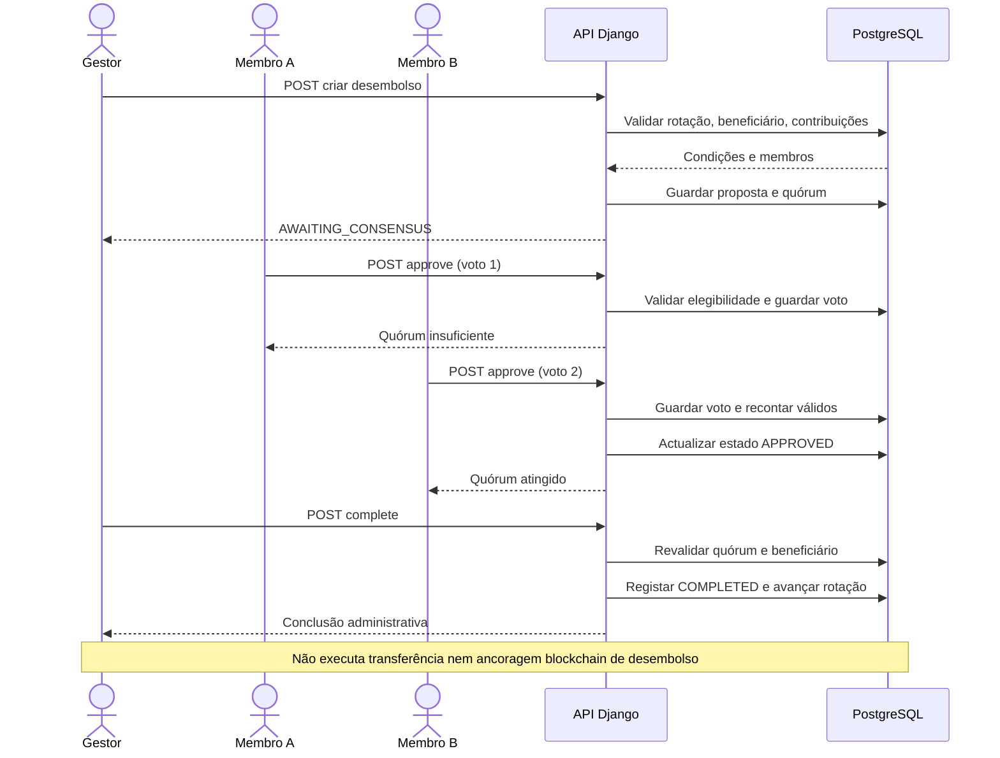

# RN06 — Diagramas A.4/A.8 e demonstração controlada (07/11/2026)

## Fonte e estatuto

- Base técnica: `feat/rn06-independent-disbursement-approval`, PR #26, derivado de PR #22 → PR #14. **Ainda não integrado em `master`.**
- Interface: `mono-frontend` PR #1, igualmente em rascunho.
- A RN06 representa **aprovação administrativa multiparticipante na API Django**, não consenso da blockchain nem assinatura autónoma dos membros.
- Os dois diagramas foram revistos na versão de trabalho da monografia: Figura A.4 (actividade) e Figura A.8 (sequência). Os originais incluíam uma API de carteira móvel e ancoragem de desembolsos não implementadas nesse fluxo. Os novos **não** incluem esses componentes.

## Fluxo confirmado pelo código

1. Gestor activo propõe desembolso do ciclo. O serviço verifica grupo, rotação, beneficiário activo, ausência de penalização activa e contribuições confirmadas.
2. O desembolso começa em `AWAITING_CONSENSUS`, mesmo se `requires_consensus=False` numa configuração legada.
3. A proposta fixa uma lista de contas elegíveis (membros activos, excluindo proponente e beneficiário), e o quórum `max(2, floor(elegíveis / 2) + 1)`.
4. Cada membro elegível autenticado pode aprovar uma única vez; votos repetidos e outros participantes são rejeitados. Com quórum, o estado muda para `APPROVED`.
5. O gestor solicita `complete`. O serviço revalida quórum e condições, regista `COMPLETED` e avança a rotação.
6. Não há movimentação de fundos, nem ancoragem de hash de desembolso no contrato.

## Figura A.4 — fonte Mermaid do fluxo



## Figura A.8 — fonte Mermaid da sequência (cenário de quatro membros)



## Demonstração reprodutível — teste de API

**Requisito:** PostgreSQL de teste e dependências Django configuradas conforme os workflows do repositório. Para demonstração de RN06, não é necessária uma confirmação de pagamento externo.

Executar em ambiente de desenvolvimento, no commit exacto do PR #26:

```bash
python -m pytest disbursements/test_independent_quorum.py -q
# Suite completa, com bases de dados e serviços de CI configurados:
python -m pytest -q
```

O teste `test_api_demo_four_members_and_two_independent_votes` executa o cenário completo com quatro identidades distintas: gestor propõe; tentativa do gestor aprovar é rejeitada; tentativa de concluir cedo é rejeitada; o membro A aprova e permanece pendente; voto repetido é rejeitado; o membro B aprova e alcança o quórum; finalmente, o gestor regista a conclusão e a rotação avança. Outros testes cobrem membro não elegível, entrada tardia e suspensão de votante.

### Roteiro para ensaio visual (5 minutos)

| Tempo | Acção | Evidência esperada |
|---|---|---|
| 0:00–0:45 | Apresentar grupo com gestor, beneficiário e dois membros votantes (dados sintéticos) | Quatro contas distintas; sem chaves reais nem dados de entrevistados |
| 0:45–1:30 | Gestor cria desembolso para ciclo cuja contribuição está marcada como confirmada no teste | `AWAITING_CONSENSUS`; quórum = 2 |
| 1:30–2:10 | Tentar que o gestor aprove ou conclua sem quórum | Operação rejeitada |
| 2:10–3:15 | Membro A aprova; tentar voto duplicado | `1/2`; duplicação rejeitada |
| 3:15–4:10 | Membro B aprova | `2/2`; `APPROVED` |
| 4:10–5:00 | Gestor conclui registo e mostra rotação; explicar limites | `COMPLETED` e rotação avançada, **sem alegar liquidação real** |

A sequência de interface só pode ser considerada **executada** depois de ensaiada manualmente com duas sessões independentes. A CI que compila a aplicação não comprova que toda a navegação visual foi ensaiada.

## Portões de aceitação

- [ ] Confirmar que o ramo tem CI Django, Brownie e PostgreSQL/Ganache aprovada no mesmo SHA.
- [ ] Executar demonstração manual UI/API com quatro contas, sem usar credenciais reais.
- [ ] Confirmar compatibilidade entre PR #26 e PR #1 do frontend.
- [ ] Rever separadamente PR #14, #22, #26 e as migrações, antes de integrar na branch principal.
- [ ] Regerar as listas de figuras/índices no Microsoft Word e verificar o apêndice antes da submissão.
- [ ] Não inferir que a votação impede desvios de fundos bancários, conluio de membros, criação de contas fictícias ou alterações privilegiadas à base de dados.

## Delimitação

A prova apresentada demonstra uma política de autorização na aplicação. **Não** constitui evidência de custódia financeira distribuída, chaves autocustodiadas, rede independente com vários validadores, confirmação por M-Pesa/e-Mola ou diminuição observada de fraudes em grupos reais.
